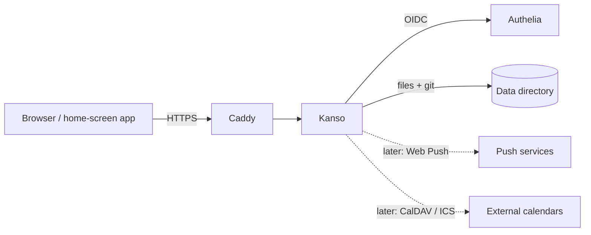

# Hüpattl! Kanso — Architecture (arc42)

**Created:** 2026-10-26
**Updated:** 2026-10-26

## 1. Introduction and Goals

Kanso is a self-hosted organiser for a family or a small team: a Markdown
wiki organised in spaces, private notes, tasks (Kanban and Eisenhower),
shared lists (shopping, wishes, links) and calendars. It replaces Docmost on
a Raspberry Pi 5 NAS and goes beyond it.

| Priority | Quality goal | Meaning |
|---|---|---|
| 1 | Data longevity | Content is plain files (Markdown, YAML, iCalendar) in Git, readable without Kanso. |
| 2 | Simplicity | One binary, no database, few dependencies, little to operate. |
| 3 | Security | Per-space permissions, safe rendering, no data leaves the host unasked. |
| 4 | Usability | Mobile first, calm Rams design, German and English. |

Stakeholders: the household (daily use), guests with accounts such as
grandparents (reading, wish lists), the operator (deploys on NixOS).

## 2. Constraints

- Go backend; HTML/CSS/JS frontend without frameworks.
- Third-party code only after a dependency check and the owner's approval
  ([ADR-002](../adr/002-dependency-policy.md)).
- License Apache-2.0; no telemetry, no CDN, no update check.
- Runs on a Raspberry Pi 5 (arm64, NixOS) behind Caddy; identity from Authelia.

## 3. Context and Scope

Kanso talks to Authelia (login) and, in later phases, to browser push
services and external calendars. Nothing else leaves the host.

## 4. Solution Strategy

- **Files + Git as the database** ([ADR-000](../adr/000-filesystem-and-git-storage.md)).
- **OIDC for identity, roles in Kanso** ([ADR-001](../adr/001-oidc-with-kanso-managed-roles.md)).
- **Edit locks instead of live collaboration** ([ADR-003](../adr/003-edit-locks.md)).
- Server-rendered pages (`html/template`); JavaScript only where it helps
  (editor, drag and drop, offline, push).
- Packages by domain capability, not by technical layer.

## 5. Building Block View

| Package | Responsibility |
|---|---|
| `internal/config` | Settings from the environment |
| `internal/store` | Safe paths, atomic files, frontmatter, Git |
| `internal/access` | Roles, groups, permission resolution |
| `internal/users` | User profiles |
| `internal/auth` | OIDC, sessions, CSRF |
| `internal/i18n` | UI strings (de, en) |
| `internal/spaces` | Spaces and their members |
| `internal/wiki` | Page tree, pages, attachments, locks, history |
| `internal/markdown` | Safe Markdown rendering |
| `internal/search` | In-memory search |
| `internal/web` | HTTP routes, templates, static files |
| `web/` | Templates, CSS, JS, fonts, vendored Mermaid |

Later phases add `notes`, `tasks`, `lists`, `calendar`, `push`.

## 6. Runtime View

**Login:** browser → `/auth/login` → Authelia (code + PKCE) →
`/auth/callback` → Kanso verifies the ID token, creates or updates the user
profile and a session; membership in `kanso-admin` sets the admin flag.

**Saving a page:** the editor holds a lock (heartbeat every 60 s). Saving
checks the lock token, writes `index.md` atomically, commits it with the
user as author, updates the page index and the search index.

## 7. Deployment View

One systemd service on the NAS (NixOS module in the homelab repository, app
as a flake input), listening on localhost behind Caddy. Data directory on the
NAS volume, state directory in `/var/lib/kanso`. Backup by the existing
Kopia jobs.

## 8. Crosscutting Concepts

- **Data layout:** see the spec, section "Datenlayout".
- **Security:** CSP without inline scripts, CSRF token plus origin check,
  path containment for every file access, attachments with fixed content types.
- **Internationalisation:** keys in `internal/i18n/{de,en}.yaml`; a test keeps
  both files in step.
- **Design:** `huepattl-rams-design`; project deviations in `docs/design.md`.

## 9. Architecture Decisions

| ADR | Title |
|---|---|
| [000](../adr/000-filesystem-and-git-storage.md) | Files in a Git repository instead of a database |
| [001](../adr/001-oidc-with-kanso-managed-roles.md) | OIDC for identity, roles and groups managed in Kanso |
| [002](../adr/002-dependency-policy.md) | Minimal, approved dependencies |
| [003](../adr/003-edit-locks.md) | Edit locks instead of live collaboration |

## 10. Quality Requirements

Verified by unit tests (`go test ./...`) and browser end-to-end tests
(`just e2e`, Playwright: desktop Chromium and iPhone WebKit).

- A page saved by two people never silently loses text (lock + 409).
- Removing a role hides the space on the next request.
- Content stays usable with `git` and a text editor alone.

## 11. Risks and Technical Debt

- Write throughput is limited by one global lock; fine for a household.
- `go.yaml.in/yaml/v3` is frozen; move to v4 once it is stable.
- Mermaid is large (lazy-loaded); its ELK layout is deliberately left out.

## 12. Glossary

| Term | Meaning |
|---|---|
| Space | A top-level area of the wiki with its own members |
| Owner / Editor / Viewer | Roles in a space: manage / write / read |
| Admin | Member of the `kanso-admin` group in the identity provider |
